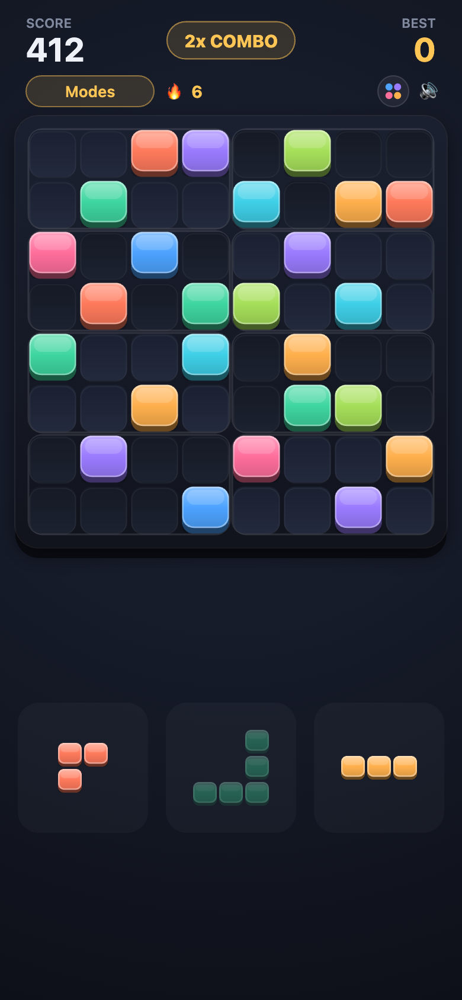
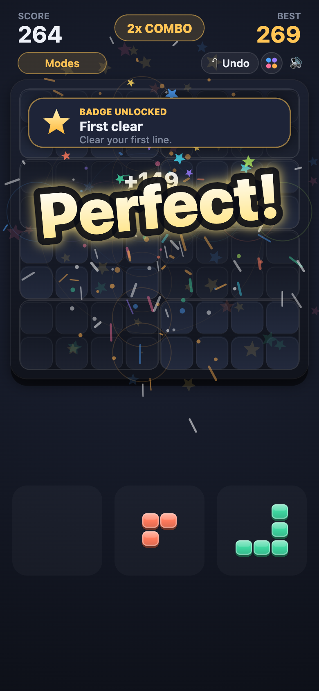
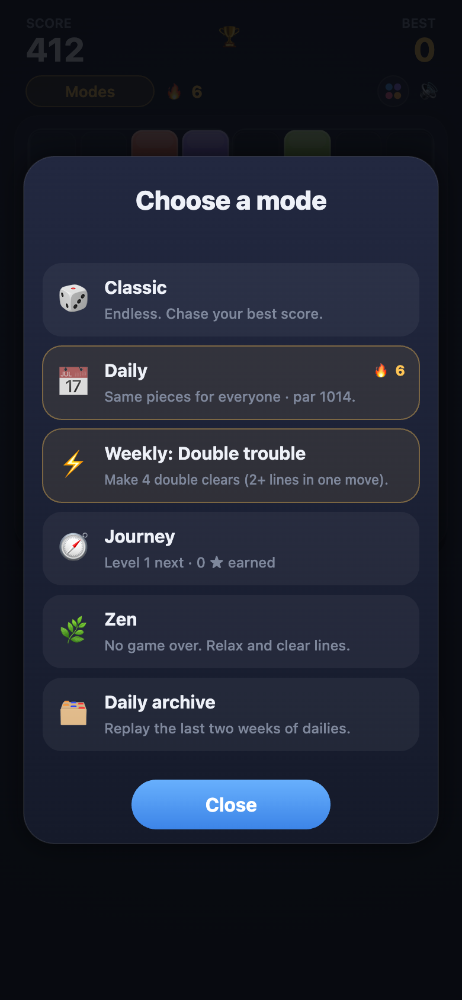
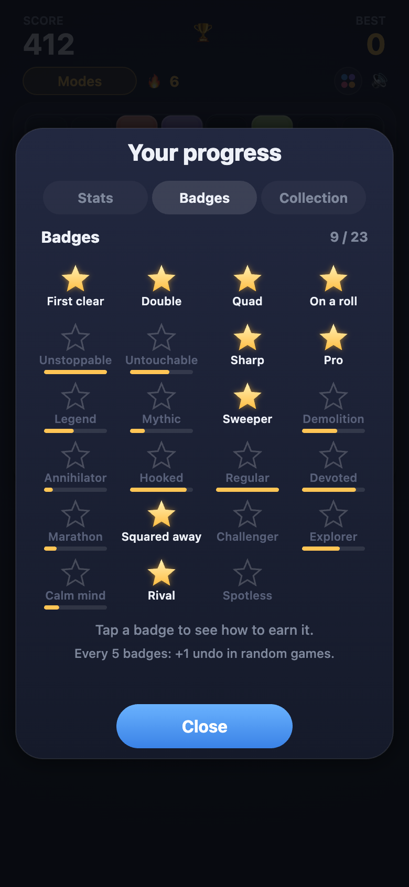
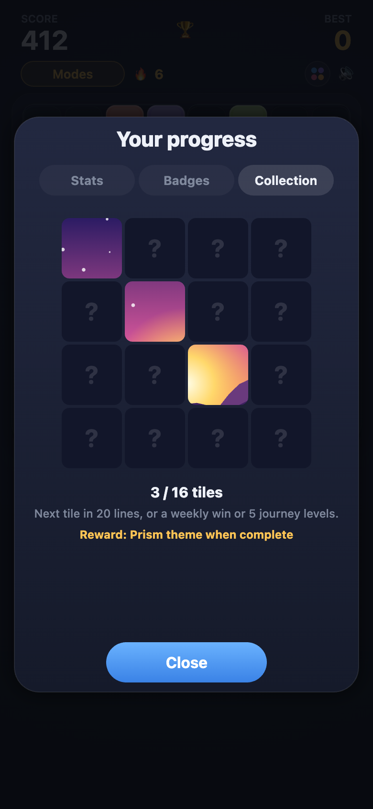
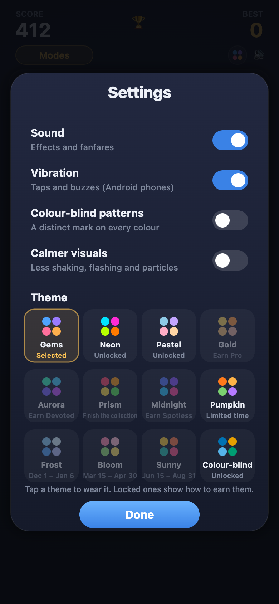

# Bun Blocks

An original 8×8 drag-and-drop block puzzle. Drag pieces from the tray onto the board and clear
rows, columns and 2×4 regions. No rotating, no timer, no ads, no backend.

**Play it: https://bunblocks.app** (works offline and installs to your home screen)

<p>
  
  
  
</p>

## How it plays

- Drag one of three pieces onto the board. Fill a **row**, a **column** or one of the eight outlined
  **2×4 regions** to clear it. Clears that cross all fire together, and consecutive clears build a combo.
- The game ends when none of the pieces left in the tray fits.
- **The piece generator never reads your score or adapts to you.** Difficulty comes only from the
  board filling up. It looks at the board for one reason: to make sure at least one piece in a tray
  can be placed.

## Modes

| Mode | What it is |
| --- | --- |
| Classic | Endless. Every game is seeded, so a shared link replays the exact same pieces. |
| Daily | The same pieces for everyone each day. Your first attempt is the record; replays are practice. Shows a **par** score. |
| Weekly | One rule-twisted goal per week, the same for everyone (for example: clear 15 lines within 45 placements). |
| Journey | 150 numbered levels with a goal and a pre-filled board, scored in stars. Every level is checked by the bot, so each one is winnable. |
| Zen | No game over: when nothing fits, the fullest line is cleared. |
| Archive | Replay any of the last 14 dailies. Archive runs never touch your streak. |

Also: challenge links (beat a friend's score on the same pieces), a daily streak with a weekly
freeze, 23 badges that unlock themes, effects and extra undos, a collectible picture, stats with a
score distribution, an emoji result you can paste anywhere, and haptics on supported phones.

**Settings:** separate switches for sound and vibration, colour-blind patterns (a distinct mark on
every colour), a calmer-visuals option, and a theme picker that includes limited-time seasonal themes.

<p>
  
  
  
</p>

## Leaderboard

Post your first daily attempt to a global board, and see the longest live daily streaks. It is
optional, anonymous and verified: you pick a public nickname (no account, no personal data), and the
server never trusts a score. Your game sends its list of moves and the server replays them with the
same rules code, so only a legal game can score. Beyond that, the server times each official attempt from
its first move (the game tells it when you start, so a score posts only if the daily was started online),
refuses a game finished faster than a person can play, caps new players per network address per day, and
only opens a day's board while that date exists somewhere on Earth. A nickname belongs to one player at a
time (lookalike spellings count as the same name). Streaks are counted from the days you post.

Every API route is rate-limited per address, and the streak board is worked out at most every 30 seconds.

## Privacy, ads and purchases

Everything here is off until configured, and none of it can change the rules or the leaderboard.

- **Usage statistics**: the server's own collector (`/api/collect`, aggregate counts only, report at
  `/admin.html` with `ADMIN_TOKEN`). The game asks once, and sends nothing (and creates no id) until the
  player says yes. Settings can turn it off again, which also deletes the id. Build-time override:
  `VITE_ANALYTICS_ENDPOINT`.
- **Shop** (Paystack, NGN): shown only when `PAYSTACK_SECRET_KEY` is set. Prices are decided and payments
  verified on the server; set the webhook to `/api/paystack-webhook`. `PAYSTACK_USD=1` enables USD.
  A test key (`sk_test_`) is refused on the production deployment, because Paystack's test cards are
  public; use it on Preview, or set `PAYSTACK_ALLOW_TEST=1` to override on purpose.
  Items are cosmetic or remove ads: no-interruptions, two theme packs, clear effects, and a supporter
  bundle that adds a star beside your name on the boards. A restore code *moves* the account (purchases,
  uncollected coins, name, streak) to another device and stops working on the old one, so a code cannot
  be shared to unlock purchases. Refunds and chargebacks (`refund.processed`, `charge.dispute.create`
  webhooks) take the purchase back; a refunded coin pack is taken from future coins if already collected.
  Sales on the admin page are counted by the server when a payment is confirmed, not reported by browsers.
- **Sign-in and cloud save** (optional for players, off until configured): `AUTH_SECRET` (at least 24
  characters; it keys the email hashes, so never change it once players have signed in) plus either or
  both of: email codes via Resend (`RESEND_API_KEY`, `EMAIL_FROM` such as `Bun Blocks <play@yourdomain>`
  on a domain verified in Resend), and Google (`GOOGLE_CLIENT_ID`, a Web OAuth client whose authorised
  JavaScript origins list the site). A signed-in device keeps a cloud save that merges with the account's
  (counters add up, bests take the higher), so two phones never overwrite each other. Signing in on a phone
  that played as a guest brings its purchases and coins into the account. Only a keyed hash of the email and
  a masked label (`ad***@gmail.com`) are stored. The game offers sign-in in Settings, before a checkout and
  after journey levels 3 and 10. Locally, `npm run dev:api` prints email codes to its terminal.
- **Admin page**: `ADMIN_TOKEN` must be at least 24 characters (shorter tokens keep the page closed);
  wrong guesses are rate-limited.
- **Ads**: loaded only when `VITE_ADSENSE_CLIENT` (a `ca-pub-` id) is set at build time; `VITE_ADSENSE_TEST=1`
  uses Google's test mode. A rewarded "watch an ad to undo" appears on game over (never in the daily, weekly
  or a challenge) and an interstitial may precede "Play again" (every 3 runs, 5 minute cooldown, never for
  owners of "No interruptions"). If the script is blocked, nothing is shown.
- **Coins**: earned by playing (a starter gift, a daily bonus, today's daily, beating par, the weekly,
  journey stars and best-score milestones), each paid once. With ads on, a rewarded ad gives coins, at most
  five a day, only after a completed view. Coins buy saved undos (never usable in the daily, weekly or a
  challenge) and two coin-only themes, from the coin counter under the trophy or Settings > Coins. With the
  shop configured, coin packs are sold through the same verified Paystack checkout: the server credits them
  once per payment and the device collects them with a retry-safe claim. Every reward and price is in
  `src/economy.ts`.

Test the shop locally with `npm run dev:api` (a fake Paystack that is refused on Vercel).

## Run it

```bash
npm install
npm run dev        # local dev server
npm test           # unit tests for the game logic
npm run build      # type-check and build to dist/
npm run dev:api    # local leaderboard API (in-memory), for use with npm run dev
```

TypeScript (strict), Vite and Canvas 2D. No game engine. The only runtime dependency is the Neon driver, used by the optional Postgres store.

## How it is built

- `src/board.ts` is the pure rules engine: no DOM, no imports. It is where bugs would hide, so it is
  heavily tested.
- Other pure, tested modules: `rng`, `streak`, `share`, `meta`, `challenge`, `journey`, `weekly`, `solver`.
- `src/main.ts` runs the game loop, the board rendering and input with Pointer Events (one code path
  for mouse and touch). The rest is split by job: `gfx` (drawing primitives and layout), `overlays`
  (the stats, modes, settings and challenge screens), `progress` (stats, badges, collection, themes,
  streak) and `records` (official dailies, par, journey progress).

### Offline tools

A greedy look-ahead bot (`src/solver.ts`) plays the real rules and the real piece generator. It is
used to calibrate the game, never to change it for a player:

```bash
npm run par        # writes public/par.json: each day's par score
npm run levels     # calibrates journey levels so every one is provably winnable
npm run validate   # checks journey, weekly goals and region shapes against the bot
```

Re-run `par` and `levels` whenever the rules or the piece set change, because both depend on them.

## License

MIT. See [LICENSE](LICENSE).

### Optional: Postgres on Neon

The server storage is Redis by default. Set `STORE=postgres` and `DATABASE_URL` (Neon) to run the same
routes on Postgres instead; tables are created on first use. `neon.ts` holds the Neon project config
(`neon deploy`). Switching does not move existing Redis data. To test: `DATABASE_URL=… npx vitest run src/server/postgres.test.ts`
runs the storage contract against the real database, and `STORE=postgres npm run dev:api` serves the app on it.

### Weekly Cup, login streak, seasonal themes, challenges

- **Weekly Cup**: the weekly mode's pieces are the same for everyone for a week (Monday to Sunday, UTC). Your first
  finished run counts and can be posted to the Cup tab of the leaderboard; the server replays the moves like it
  does for the daily. When the week ends, the top 10 get coins (`ECONOMY.cup` in `src/economy.ts`), paid once into
  the same server-held balance that bought coins use, and the device collects it on its next visit.
- **Login streak**: opening the game on consecutive days adds bonus coins on some days (`ECONOMY.loginStreak`); a
  missed day restarts it. It is on top of the daily bonus.
- **Seasonal themes**: limited-window themes (`season` in `src/progress.ts`) are wearable only inside their dates.
- **Challenge a friend**: the game-over button on a random game shares a link with the seed and your score.

### Backups

`npx vite-node scripts/backup.ts` (after `vercel env pull .env.local`) saves every Redis key to `backups/redis-<date>.json`
(git-ignored; it holds player data, so keep it private). `scripts/restore.ts <file> --yes` puts it back and replaces
keys of the same name. Anonymous distinct-count statistics cannot be exported and start counting again.

## Android and iOS (Capacitor phase one)

The browser release still uses `npm run build` → `dist/`. Native builds use
`npm run build:native` → `dist-native/`, bundled inside the application for offline play.
The native build disables AdSense, Paystack checkout, Google browser sign-in, PWA installation,
and service workers. Ads and native purchases stay disabled pending verified integrations.
The existing Canvas game, game rules, scoring, modes and replay verification are shared unchanged.

```sh
npm ci
npm test
npm run validate
npm run build
npm run cap:sync
npm run check:mobile
npm run android:build
npm run android:open
# After Android verification:
npm run ios:open
```

Use Node 22+, the Android Studio JDK (21+), Android SDK 36, and Xcode 26+.
`ANDROID_HOME` must point to the SDK; use `JAVA_HOME` for Android Studio's bundled JDK.
Run `npx cap sync` after pulling dependencies or rebuilding native assets. Never point
Capacitor `server.url` at the live website: the packaged shell is the offline application.

See [the migration report](docs/mobile-migration.md) for exact changes, validation results,
compatibility limitations, device checks, and the production/store submission checklist.
No production deployment or merge is part of this phase.

### Download Android and iOS test builds

Open [Mobile builds in GitHub Actions](https://github.com/uchedavid50-oss/blockpuzzle/actions/workflows/mobile-builds.yml),
select a successful run for `mobile/capacitor-phase-one`, and download its **Artifacts** at the
bottom of the run page (sign in to GitHub). The job summaries also contain download links.

| Artifact | Contents | Where it runs |
| --- | --- | --- |
| `bunblocks-android-debug-<run>` | `bunblocks-debug.apk`, checksum, build info | Android 7.0+ device or emulator |
| `bunblocks-ios-simulator-arm64-<run>` | `bunblocks-ios-simulator-arm64.tar.gz`, checksum, build info | iOS Simulator on an Apple silicon Mac with Xcode |

The [workflow](.github/workflows/mobile-builds.yml) runs automatically on pushes to `mobile/**`
and pull requests targeting `main`. Tests, the existing validation script, both Vite builds,
and web/native boundary checks must pass before Android builds; iOS builds after Android.
Artifacts expire after 14 days. Re-run a workflow or push a new mobile-branch commit to regenerate
them. A **Run workflow** button becomes available once this workflow exists on the default
branch; until then use the automatic mobile-branch push runs and **Re-run all jobs**.
Nothing in this workflow merges code, deploys the website, or uploads to either store.
It requires no signing secrets. Actions are pinned to commit SHAs, with read-only repository permissions.

**Android:** unzip the downloaded artifact, transfer `bunblocks-debug.apk` to your Android
device and open it. Allow installation from the file/browser app when Android asks.
Alternatively, connect an emulator/device and run:

```sh
adb install -r bunblocks-debug.apk
```

This APK is signed with a development key, not a store release key. Each hosted runner can
generate a different debug signing key, so an update from another run may require uninstalling
the previous build. **Uninstalling removes local saves**: sync progress first if cloud saves
are available, or keep the existing install until durable signing/backup is configured.
Native online services still require the approved CORS deployment described in the migration report.
Ads and purchases remain disabled.

**iOS Simulator:** unzip the artifact, extract the tar archive, start a simulator in Xcode,
then install and launch the app:

```sh
tar -xzf bunblocks-ios-simulator-arm64.tar.gz
xcrun simctl install booted App.app
xcrun simctl launch booted app.bunblocks.game
```

The `.app` is unsigned and built for an arm64 simulator; it cannot be installed on an iPhone
or an Intel Mac simulator. A physical iPhone `.ipa` / TestFlight build needs the correct
Apple Developer team, distribution certificate/private key, provisioning profile, and an
export method. Configure those in a separate signing workflow using GitHub secrets/environments
before creating device releases. Never commit signing keys or profiles.
See [Apple's distribution guide](https://developer.apple.com/documentation/xcode/distributing-your-app-for-beta-testing-and-releases).

For local builds, `npm run android:build` creates
`android/app/build/outputs/apk/debug/app-debug.apk`. Use `npm run ios:open` to open the native
project in Xcode and build for a simulator or configure a development team for your iPhone.

### Native rendering and launcher artwork

Native builds cap Canvas raster resolution to a one-million-pixel budget (at most 2× density),
without changing CSS layout, touch coordinates or game rules. Board frames/empty cells, repeated
blocks and controls reuse bounded raster caches. Background light is rasterized at 10 Hz while
input and gameplay animations continue at display cadence. Browser rendering keeps its existing
resolution and drawing path.

Android launcher icons (legacy and adaptive) and the iOS 1024px icon derive from the existing
`public/icon-512.png` logo. To regenerate them on macOS after changing that source:

```sh
swift scripts/make-mobile-icons.swift
```

Regeneration changes only native launcher assets; it does not change the website icons or AdSense tag.
