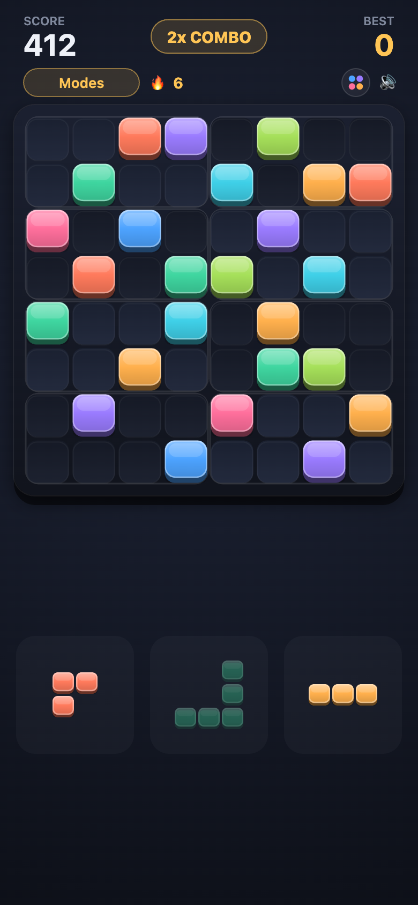
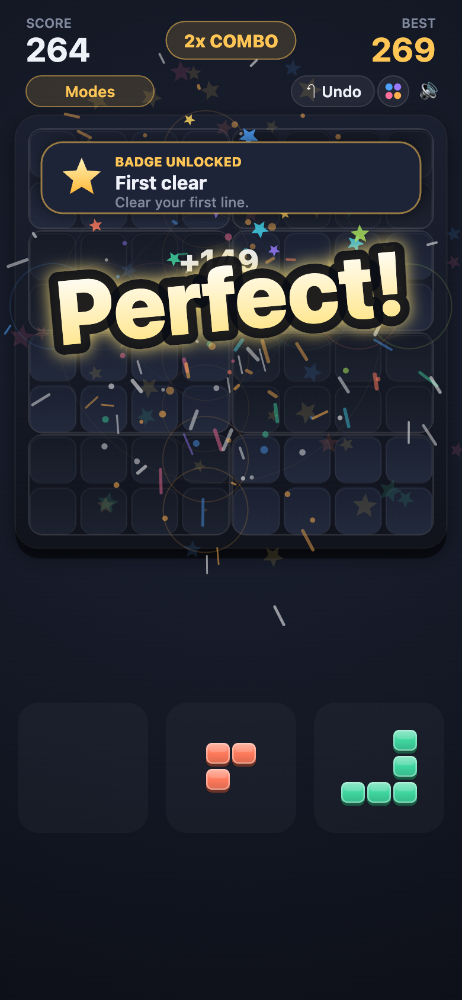
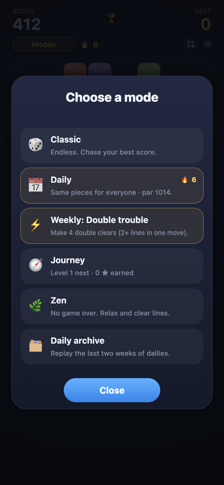
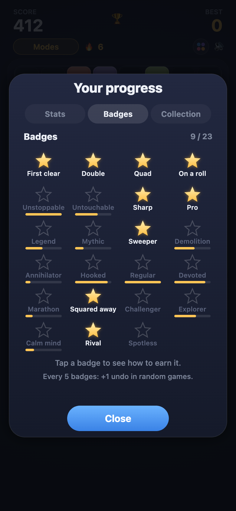
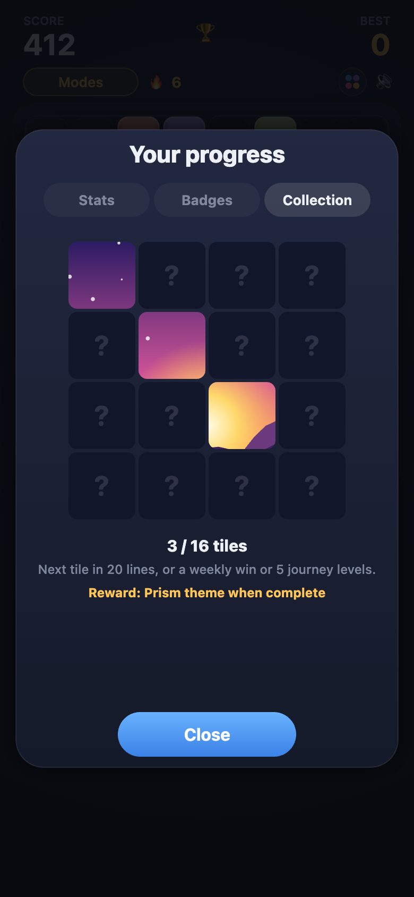
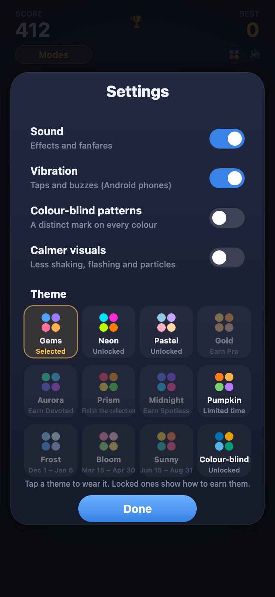

# Block Puzzle

An original 8×8 drag-and-drop block puzzle. Drag pieces from the tray onto the board and clear
rows, columns and 2×4 regions. No rotating, no timer, no ads, no backend.

**Play it: https://blockpuzzle-three.vercel.app** (works offline and installs to your home screen)

<p>
  
  
  
</p>

## How it plays

- Drag one of three pieces onto the board. Fill a **row**, a **column** or one of the eight outlined
  **2×4 regions** to clear it. Clears that cross all fire together, and consecutive clears build a combo.
- The game ends when none of the pieces left in the tray fits.
- **The piece generator never reads your score or adapts to you.** Difficulty comes only from the
  board filling up. It looks at the board for one reason: to make sure at least one piece in a tray
  can be placed.

## Modes

| Mode | What it is |
| --- | --- |
| Classic | Endless. Every game is seeded, so a shared link replays the exact same pieces. |
| Daily | The same pieces for everyone each day. Your first attempt is the record; replays are practice. Shows a **par** score. |
| Weekly | One rule-twisted goal per week, the same for everyone (for example: clear 15 lines within 45 placements). |
| Journey | 150 numbered levels with a goal and a pre-filled board, scored in stars. Every level is checked by the bot, so each one is winnable. |
| Zen | No game over: when nothing fits, the fullest line is cleared. |
| Archive | Replay any of the last 14 dailies. Archive runs never touch your streak. |

Also: challenge links (beat a friend's score on the same pieces), a daily streak with a weekly
freeze, 23 badges that unlock themes, effects and extra undos, a collectible picture, stats with a
score distribution, an emoji result you can paste anywhere, and haptics on supported phones.

**Settings:** separate switches for sound and vibration, colour-blind patterns (a distinct mark on
every colour), a calmer-visuals option, and a theme picker that includes limited-time seasonal themes.

<p>
  
  
  
</p>

## Run it

```bash
npm install
npm run dev        # local dev server
npm test           # unit tests for the game logic
npm run build      # type-check and build to dist/
```

TypeScript (strict), Vite and Canvas 2D. No game engine and no runtime dependencies.

## How it is built

- `src/board.ts` is the pure rules engine: no DOM, no imports. It is where bugs would hide, so it is
  heavily tested.
- Other pure, tested modules: `rng`, `streak`, `share`, `meta`, `challenge`, `journey`, `weekly`, `solver`.
- `src/main.ts` runs the game loop, the board rendering and input with Pointer Events (one code path
  for mouse and touch). The rest is split by job: `gfx` (drawing primitives and layout), `overlays`
  (the stats, modes, settings and challenge screens), `progress` (stats, badges, collection, themes,
  streak) and `records` (official dailies, par, journey progress).

### Offline tools

A greedy look-ahead bot (`src/solver.ts`) plays the real rules and the real piece generator. It is
used to calibrate the game, never to change it for a player:

```bash
npm run par        # writes public/par.json: each day's par score
npm run levels     # calibrates journey levels so every one is provably winnable
npm run validate   # checks journey, weekly goals and region shapes against the bot
```

Re-run `par` and `levels` whenever the rules or the piece set change, because both depend on them.

## License

MIT. See [LICENSE](LICENSE).
